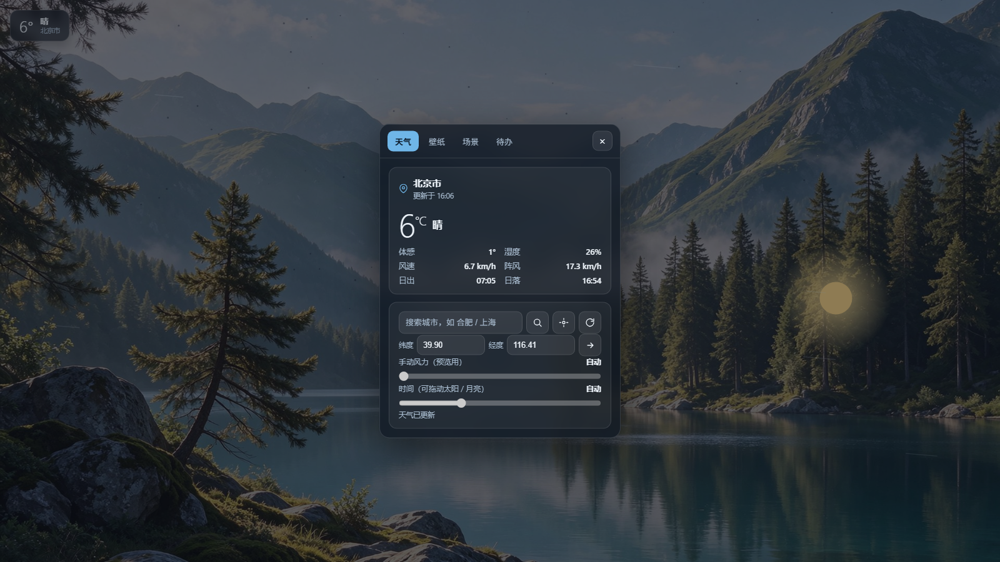

# 实时天气壁纸 · Lively Weather Wallpaper

一款 Windows 桌面动态天气壁纸：真实天气驱动昼夜色调、云雨雪雾雷暴，带天气面板、待办清单和多屏分城市。纯单文件 HTML + 本地素材，不需要服务器、不需要 API Key。




## 功能

- **实时天气**：Open-Meteo 免费接口，温度、体感、湿度、风速/阵风、日出日落
- **动态场景**：昼夜色调、星空、太阳/月亮（可拖动控制时间）、云、雨、雪、雾、雷暴、落叶
- **控制面板**：城市搜索、定位当前位置、9 张本地壁纸、场景预览、风力/时间手动调节
- **待办清单**：今日待办、未来待办按日期分组、完成进度、悬浮窗模式、固定位置（仍可点击）
- **多显示器**：每块屏可显示不同城市（slot 机制，见下文）
- **定位兜底**：系统定位优先；失败沿用上次成功位置；VPN/代理出口在境外时直接忽略 IP 定位，不会把城市改错
- **本地存储**：城市、壁纸、待办、窗口位置都存在本机，不上传

## 环境要求

- Windows 10 / 11
- [Lively Wallpaper](https://livelywallpaper.app)（免费；微软商店搜索 “Lively Wallpaper”，作者 rocksdanister）
- WebView2 Runtime（Windows 10/11 一般已自带）

## 安装

1. 安装 Lively Wallpaper。
2. 下载本仓库：`Code` → `Download ZIP`，解压。
3. 打开 Lively 主窗口，把 **`WeatherWallpaper` 整个文件夹**拖进窗口；或点“添加壁纸”选择文件夹里的 `index.html`。
4. 在 Lively 里右键该壁纸 → 设为壁纸。
5. **重要：打开网页数据持久化**，否则待办和城市在重启后会丢：
   用记事本打开 `%LOCALAPPDATA%\Lively Wallpaper\Settings.json`，
   把 `"CefDiskCache": false` 改成 `"CefDiskCache": true`，保存后退出并重启 Lively。
6. 首次打开：点左上角天气小条 → 点“定位当前位置”，或直接搜索自己的城市。

> 默认城市是昆明。第一次使用请点定位或搜索一次自己的城市，之后会记住。

### 让豆包帮你装

把下面这段发给对方电脑上的豆包（把压缩包一起发给它）：

```text
我发给你 WeatherWallpaper-share.zip（实时天气动态壁纸），请帮我：
1. 解压到 D:\Wallpapers；
2. 如果没装 Lively Wallpaper，帮我安装（微软商店搜索 Lively Wallpaper，作者 rocksdanister；或用 winget 安装）；
3. 打开 Lively，把整个 WeatherWallpaper 文件夹拖进去，并设为当前桌面壁纸；
4. 用记事本打开 %LOCALAPPDATA%\Lively Wallpaper\Settings.json，把 "CefDiskCache": false 改成 true，然后退出并重新启动 Lively；
5. 完成后确认桌面已经显示壁纸，并告诉我怎么打开天气面板。
```

## 使用

- 点左上角天气小条打开设置面板；小条可拖动到任意位置。
- 三击太阳或月亮，打开待办悬浮窗；右上角图钉可固定位置（固定后仍可点击勾选）。
- 搜索框输入城市名，回车选择；选中后长期记住。
- 待办支持选未来日期，按“今天 / 明天 / 后天”分组展示，到期自动进入今日列表。

## 多显示器显示不同城市

1. 把 `WeatherWallpaper` 复制一份为 `WeatherWallpaper2`。
2. 在 `WeatherWallpaper2/index.html` 的 `<head>` 后插入一行：
   ```html
   <script>window.FORCED_LOC={slot:"monitor2"};</script>
   ```
3. 打开 Lively 设置 → 通用 → 输出，切换为“每台显示器（Per Display）”，分别指定两块屏的壁纸。
4. 两个实例的存储按 `slot` 隔离，各自记住自己的城市。

## 定位与 VPN

- 定位优先使用系统定位（Windows 位置服务），不依赖网络出口 IP。
- 系统定位失败时沿用上次成功的位置，不会退回默认城市。
- 网络出口在境外（开 VPN/代理）时，IP 定位结果会被直接忽略，避免把城市定到美国。
- 反查城市名使用 BigDataCloud 与 OpenStreetMap Nominatim；都失败时用内置城市表按最近城市命名，不会出现“24.87, 102.86”这种坐标当城市名。

## 隐私

- 天气：坐标发送给 Open-Meteo 用于取天气。
- 反查城市名：坐标发送给 BigDataCloud / Nominatim。
- 待办、城市、壁纸、窗口位置仅保存在本机 `localStorage`，不上传、不包含在仓库里。
- 仓库内不含任何个人待办数据。

## 常见问题

**重启后待办/城市丢了**
没开 `CefDiskCache`，按安装第 5 步修改 `Settings.json` 并重启 Lively。

**定位时弹出“允许/总是允许/不允许”，按钮点不动**
这是 Lively/WebView2 宿主的权限气泡问题，页面控制不了。直接关闭气泡，用搜索框输入城市名即可，不影响其他功能。

**只复制 index.html，壁纸不显示/缺图**
必须整个文件夹一起复制，`assets` 里是壁纸素材。

**天气不更新**
需要联网；Open-Meteo 偶发超时会自动重试，恢复网络后点面板里的刷新按钮。

## 目录结构

```
WeatherWallpaper/
  index.html        壁纸主文件（HTML + CSS + JS）
  assets/           9 张本地壁纸
  thumbnail.jpg     Lively 缩略图
  LivelyInfo.json   Lively 壁纸元信息
docs/               README 截图
```

## 致谢

- 天气数据：[Open-Meteo](https://open-meteo.com/)
- 城市反查：[BigDataCloud](https://www.bigdatacloud.com/)、[OpenStreetMap Nominatim](https://nominatim.org/)
- 壁纸宿主：[Lively Wallpaper](https://livelywallpaper.app/)

## License

MIT
